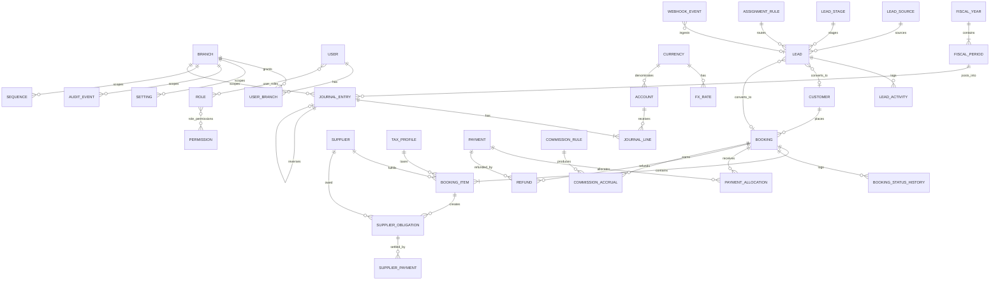

# ERD — Tourism ERP (MVP)

Status: Draft. Money columns are `*_minor bigint` + `currency char(3)` unless noted. All operational tables carry `branch_id`.



## Core tables (contract summary)

| Table | Key columns / invariants |
|---|---|
| `branches` | `public_id`, `code` unique, `name_ar/name_en`, `accounting_mode` (`dimension/customer/independent`), `is_active`. |
| `users` | `public_id`, `name`, `email` unique, `password`, `locale`, `is_active`, `last_login_at`. |
| `user_branch` | `(user_id, branch_id)` unique. |
| `roles/permissions` | Spatie tables; `model_has_roles` includes team-free assignment. |
| `settings` | `group`, `key`, `value` (encrypted for secrets), unique `(group,key)`, `is_secret`. |
| `audit_events` | append-only; `actor_id`, `action`, `entity_type/id`, `before`, `after` (redacted), `ip`, `request_id`, `created_at`. |
| `sequences` | `document_type`, `branch_id`, `year`, `prefix`, `next_value`, `gap_policy`; unique `(document_type,branch_id,year)`. |
| `currencies` | `code` PK/unique, `name`, `exponent`, `symbol`, `is_active`. |
| `fx_rates` | `currency_code`, `rate numeric(20,10)`, `rate_date`, `source`; unique `(currency_code, rate_date, source)`. |
| `accounts` | `public_id`, `code` unique, `name_ar/name_en`, `type`, `parent_id`, `is_postable`, `currency_code` nullable, `is_active`. |
| `fiscal_years` | `name`, `starts_on`, `ends_on`, unique non-overlap per installation. |
| `fiscal_periods` | `fiscal_year_id`, `starts_on`, `ends_on`, `status` (`open/soft_closed/closed`). |
| `journal_entries` | `public_id`, `number`, `entry_date`, `branch_id`, `fiscal_period_id`, `currency_code`, `fx_rate`, `fx_rate_date`, `fx_rate_source`, `status` (`draft/posted`), `source_type/source_id`, `event`, `reversal_of_id`, `posted_at/by`; unique `(source_type,source_id,event)`, unique `reversal_of_id`. |
| `journal_lines` | `journal_entry_id`, `account_id`, `debit_minor`, `credit_minor`, `base_debit_minor`, `base_credit_minor`, `currency_code`, `party_type/party_id`, `branch_id`, `description`. Check debit xor credit. |
| `customers` | `public_id`, `type`, `name_ar/name_en`, `phone`, `email`, `tax_id`, `branch_id`, `credit_limit_minor`, `is_active`; normalized phone index. |
| `suppliers` | `public_id`, `category` (`airline/hotel_eg/hotel_sa/transport/visa/agent/other`), names, `settlement_currency`, `branch_id`, `is_active`. |
| `tax_profiles` | `name`, `rate numeric(9,4)`, `is_inclusive`, `sales_account_id`, `purchase_account_id`, `effective_from/to`, `is_active`. |
| `bookings` | `public_id`, `number`, `customer_id`, `branch_id`, `owner_user_id`, `status`, `currency_code`, `fx_rate/date/source`, dates, pax, totals in minor, `confirmed_at`, `cancelled_at`, `cancellation_policy` snapshot. |
| `booking_items` | `booking_id`, `service_type`, `supplier_id`, `description`, dates, `quantity`, `unit_cost_minor`, `unit_sell_minor`, `cost_currency`, `sell_currency`, `tax_profile_id`, `tax_rate_snapshot`, `tax_minor`, `total_sell_minor`, `total_cost_minor`. |
| `booking_status_history` | `booking_id`, `from_status`, `to_status`, `reason`, `actor_id`, `created_at`. |
| `payments` | `public_id`, `number`, `customer_id`, `booking_id` nullable, `branch_id`, `method`, `cash_account_id`, `amount_minor`, `currency_code`, `fx_rate/date/source`, `unallocated_minor`, `status`, `idempotency_key` nullable. |
| `payment_allocations` | `payment_id`, `booking_id`, `amount_minor`; sum ≤ payment amount. |
| `refunds` | `public_id`, `number`, `payment_id`, `booking_id`, `amount_minor`, `currency_code`, `reason`, `status`, `approved_by`, `approved_at`. |
| `supplier_obligations` | `public_id`, `supplier_id`, `booking_item_id`, `amount_minor`, `currency_code`, `invoice_reference`, `status` (`open/partially_paid/paid/void`). |
| `supplier_payments` | `public_id`, `supplier_id`, `supplier_obligation_id` nullable, `amount_minor`, `currency_code`, `cash_account_id`, `status`. |
| `commission_rules` | `scope_type/scope_id`, `basis`, `rate`, `payee_type/payee_id`, `effective_from/to`, `is_active`. |
| `commission_accruals` | `public_id`, `booking_id`, `booking_item_id` nullable, `rule_id`, `payee_type/payee_id`, `basis_minor`, `amount_minor`, `status` (`accrued/approved/paid/void`), unique `(rule_id, booking_id, booking_item_id)`. |
| `leads` | `public_id`, `source_id`, `external_id`, `name`, `phone`, `email`, `branch_id`, `stage_id`, `owner_user_id`, `status`, `consent`, `first_response_at`, `last_activity_at`, `converted_customer_id`, `converted_booking_id`. |
| `lead_activities` | `lead_id`, `type`, `body`, `actor_id`, `created_at`. |
| `assignment_rules` | `priority`, `branch_id` nullable, `source_id` nullable, `strategy`, `max_leads_per_user`, `is_active`. |
| `webhook_events` | `provider`, `external_event_id`, `payload` (redacted), `status`, `attempts`; unique `(provider, external_event_id)`. |
| `idempotency_keys` | `actor_id`, `key`, `method`, `path`, `request_hash`, `response_status/body`, unique `(actor_id,key)`. |
| `outbox_events` | `event_id`, `type`, `payload`, `published_at`, `attempts`. |
```
