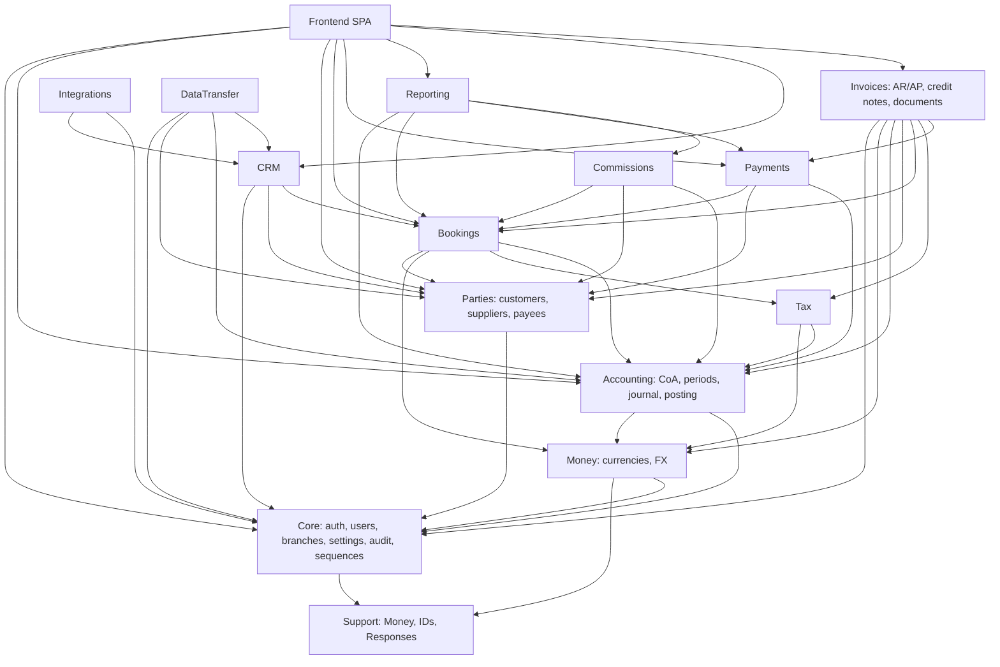

# Dependency Graph — Tourism ERP

Status: Draft. Arrows mean "depends on / calls". Cycles are forbidden.

## Known coupling (not drawn as cycles)

`Payments` and `Reports` reference `Invoices` Eloquent models directly
(`InvoiceApplication` relations, invoice statements and aging). Those inbound
model references are deliberately not drawn as `PAY --> INVOICE` /
`RPT --> INVOICE` edges because that would form a cycle; moving them behind a
query service/contract is architect-approved follow-up work (rules 4 and 7).

## Rules

1. `Accounting` must **not** import `Bookings`, `Payments`, `Commissions`, or `CRM`. It exposes `PostingService` and consumes events.
2. `Bookings` must not write journals directly; it calls the posting contract.
3. `CRM` must not write booking tables; conversion calls the Bookings service.
4. `Reporting` must not use another module's Eloquent models; it uses query services/read models.
5. `Integrations` must not read the ledger.
6. `Support` must not depend on any module.
7. New edges require architect approval and an ADR update.

## Enforcement

- Review checklist per PR.
- Static check (CI) that bans cross-module namespace imports outside allowed edges.
- Contract tests for public services/events.
