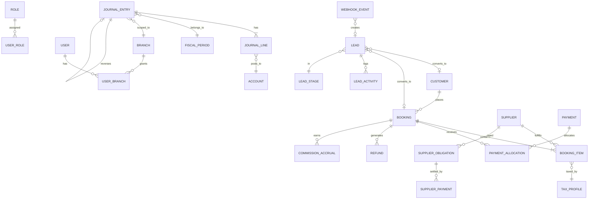

# PRD — Tourism ERP

| Field | Value |
|---|---|
| Status | Draft for human review |
| Version | 0.1 |
| Owner | Architect / Product Analyst |
| Source inputs | `reference/SOURCE_SCOPE.md` (Safe Way offer summary), `reference/PRODUCT_CONTEXT.md`, `tourism_erp_agent_prompts/*` |
| Supersedes | Nothing (first product blueprint) |
| Coding status | **STOPPED** — this document is a prerequisite for architecture and implementation |

> **Input warning:** the full Safe Way proposal and the user's design system are **not present** in this repository. Only a summarized source scope was supplied. Every requirement derived from the summary is marked; items that depend on the full proposal are recorded in `decisions-needed.md`. No screen design is proposed here.

---

## 1. Product summary

A reusable, self-hosted **Tourism ERP** for travel agencies: accounting, multi-service bookings, payments, suppliers, commissions, tax, financial reporting, CRM/lead routing, and Meta/WhatsApp integrations, delivered in Arabic (RTL) and English as a responsive web application.

**One codebase, many installations.** Each customer receives a separately deployed and configured instance on their own server. There is no shared database, no `tenant_id`, no SaaS control plane, and no per-customer fork.

**First reference deployment:** Safe Way (Egypt-based travel agency, EGP/SAR/USD, ~10 users, 2–3 branches). Safe Way supplies scope and validation data only; branding, chart of accounts, tax rules, branches, and integrations are configuration.

### 1.1 Product principles

1. **Configuration over forks.** Client differences are settings, feature toggles, master data, and templates — never code branches.
2. **Accounting is the spine.** Every money-moving business action produces a balanced, traceable, immutable posting (or an explicit, documented reason it does not).
3. **Money is exact.** `DECIMAL/NUMERIC` in storage and integer minor units in domain code. Floats are forbidden for money and FX.
4. **Contracts before code.** Shared schemas and APIs require architect approval; business rules require accountant approval.
5. **Design system is law.** Screens are assembled from the supplied design system, never from an invented parallel UI kit.
6. **Traceability.** Every document, posting, status change, and webhook is attributable to an actor, time, and source.
7. **Deployable by a human.** Clean install, migration, backup, restore, and rollback are first-class, tested deliverables.

### 1.2 Explicit non-goals

- SaaS, multi-tenancy, per-client code forks, source-code resale.
- Native mobile applications.
- Payment-gateway processing, bank feeds, OCR, payroll, inventory, customer/supplier self-service portals in MVP.
- Legacy full data migration (import tooling supports master data and opening balances only).
- Bearing external API fees, domain, hosting, or credential procurement.

---

## 2. Deployment, tenancy, and configuration model

| Aspect | Decision |
|---|---|
| Tenancy | One legal entity per installation (MVP). Multi-company is a later, separately approved capability. |
| Deployment | Docker Compose on a customer-owned server; Laravel API + queue worker + scheduler, PostgreSQL, Redis, web server, React SPA build. |
| Configuration | Installation settings + feature toggles + seeded master data + templates (PDF, notifications). |
| Branding | Logo, legal name, tax registration, address, colors/fonts from the design system theme, document headers/footers. |
| Environments | Local, staging (per release), production (per customer). No shared production data between customers. |
| Upgrade path | Versioned releases, forward migrations, documented rollback, backup before migrate. |
| Secrets | Environment/secret store only; never committed, never stored in DB plaintext, never logged. |
| Identifiers | UUID/ULID for public IDs; bigint internal keys allowed. No tenant scoping column. |

---

## 3. Actors and roles

| Actor | Description | Typical permissions |
|---|---|---|
| Installation Administrator | Owns the instance, users, branches, settings, integrations. | Full admin; no implicit financial posting. |
| Branch Manager | Runs one or more branches. | Branch-scoped operations, approvals, reports; may post if granted. |
| Chief Accountant | Owns the ledger, periods, chart of accounts, closing. | Post/reverse/close, all financial reports, configuration of accounting rules. |
| Accountant | Day-to-day entries, receipts, payments, reconciliation. | Create/post within limits, no period close. |
| Sales Agent / Consultant | Creates and owns bookings and leads. | Bookings, customers, own pipeline, limited discount authority. |
| Operations Coordinator | Executes bookings, supplier coordination, service dates. | Booking operations, supplier data, no ledger posting. |
| CRM / Marketing User | Lead intake, assignment, pipeline hygiene, campaigns. | Leads, sources, stages, assignment rules; no financial data. |
| Auditor | Read-only assurance. | Read all financial and audit data; no mutation. |
| Integration Service Account | Machine identity for webhooks/queue jobs. | Narrow scoped endpoints only. |
| Customer / Supplier (external) | Parties on documents; **no login in MVP**. | n/a |

Permissions are granular (permission + branch scope), grouped into editable roles. A user may hold multiple roles and multiple branches. Segregation-of-duties rules are configurable but must support "creator cannot approve own payment/refund" when enabled.

---

## 4. Scope classification

### 4.1 MVP (first customer deployment)

Accounting (chart of accounts, journals, cash/bank, expenses, opening balances, fiscal periods/closing, AR/AP), multi-currency with per-transaction FX, customers and categorized suppliers, multi-service bookings with costing and profitability, partial payments, refunds/cancellations, commissions, configurable tax, financial reports with branded PDF, CRM with lead sources and 24-hour reassignment, Meta Lead Ads and WhatsApp Business ingestion/sending, roles and branch scopes, CSV/Excel import/export, Arabic RTL + English responsive UI, audit trail, backup/restore.

### 4.2 Later (designed for, not built in MVP)

Customer/supplier portals, online payment collection, bank statement import/reconciliation automation, OCR of supplier invoices, multi-company consolidation, advanced BI/warehouse, native mobile app, e-signature, automated commission self-service, WhatsApp template marketing automation.

### 4.3 Explicitly excluded

SaaS/multi-tenant hosting, per-client source forks, external API fees/credentials, domain/hosting costs, full legacy migration, source-code ownership transfer, payroll, inventory/stock, general HR.

---

## 5. Domain model (conceptual)

Key entity groups:

- **Party:** customer, supplier (+ category), contact, address, tax identifiers.
- **Catalog/config:** branch, user, role, permission, currency, FX rate, tax setting, commission rule, document sequence, feature flag, setting.
- **Commercial:** booking, booking item (service), booking status history, quotation/version (later), cancellation policy snapshot.
- **Money movement:** payment/receipt, payment allocation, refund, supplier obligation, supplier payment, expense, cash/bank account, transfer.
- **Ledger:** account (nested), fiscal year, fiscal period, journal entry, journal line, opening balance batch, period close, reversal link.
- **CRM:** lead, lead source, lead stage, assignment rule, lead activity, webhook event, WhatsApp message.
- **Platform:** audit event, attachment, import batch, export job, idempotency key, notification, saved filter/report definition.

### 5.1 Canonical identifiers and fields (contract-level, to be finalized in ADRs)

| Entity | Required invariants |
|---|---|
| `journal_entries` | Balanced in transaction currency **and** base currency; posted rows immutable; `reversal_of_id` unique; `source_type/source_id` traceable; `branch_id` required; `fx_rate > 0`. |
| `journal_lines` | Exactly one side non-zero per line (debit xor credit); account must be postable; party optional but required for control accounts. |
| `bookings` | Snapshot currency + FX rate at confirmation; status transitions only via allowed graph; totals derived from items; no hard delete after confirmation. |
| `payments` | Amount > 0; allocation sum ≤ payment amount; unallocated remainder tracked as customer advance; refund ≤ net collected. |
| `commission_accruals` | Unique per rule + basis document; immutable after approval; void via reversal, not edit. |
| `leads` | `(source, external_event_id)` idempotent; assignment history retained; conversion is one-way and audited. |
| `audit_events` | Append-only; before/after snapshots redact secrets and sensitive PII. |

---

## 6. Functional requirements

Priority: **M** = MVP mandatory, **S** = MVP should, **L** = later.

### 6.1 Core platform (CORE)

| ID | Requirement | Pri |
|---|---|---|
| FR-CORE-001 | Authenticate users with email + password (Laravel Sanctum), rate-limited, session revocation, password policy, optional TOTP later. | M |
| FR-CORE-002 | Manage users, roles, and granular permissions; deny by default on every endpoint. | M |
| FR-CORE-003 | Manage branches; assign users to one or more branches; all operational data carries a branch. | M |
| FR-CORE-004 | Installation settings: legal identity, base currency, timezone, locale, fiscal year start, document numbering, branding, feature toggles. | M |
| FR-CORE-005 | Currencies and FX rates: enable EGP/SAR/USD and more; manual rate per transaction with rate date and source; snapshot on documents/postings. | M |
| FR-CORE-006 | Audit trail for create/update/delete/post/reverse/approve/login/export, with actor, IP, request ID, redacted before/after. | M |
| FR-CORE-007 | Configurable document sequences (booking, receipt, refund, journal, expense, supplier payment) with per-branch/year reset and gap policy. | M |
| FR-CORE-008 | Attachments on bookings, expenses, payments, suppliers (type/size limits, virus-safe storage, access-controlled). | S |
| FR-CORE-009 | Health endpoint, structured logs, request IDs, queue/scheduler monitoring. | M |
| FR-CORE-010 | Feature toggles per installation for optional modules/integrations (CRM, Meta, WhatsApp, commissions). | M |

### 6.2 Accounting (FIN)

| ID | Requirement | Pri |
|---|---|---|
| FR-FIN-001 | Nested chart of accounts with types (asset, liability, equity, revenue, expense), parent/child, postable flag, currency restriction, active/inactive, branch-agnostic unless configured. | M |
| FR-FIN-002 | Fiscal years and periods; period open/soft-closed/closed; posting blocked into closed periods. | M |
| FR-FIN-003 | Manual journal entries with draft → posted; line-level debit/credit, account, party, branch, cost/profit dimension; balanced validation in transaction and base currency. | M |
| FR-FIN-004 | Immutable posted entries; corrections only through reversal entries linked to the original; reversal requires reason and permission. | M |
| FR-FIN-005 | Opening balances: dated batch import per account/party/currency, validated and posted once per cutover; re-open requires privileged correction flow. | M |
| FR-FIN-006 | Cash and bank accounts as ledger-linked accounts; deposits, withdrawals, internal transfers with dual-sided postings and FX handling. | M |
| FR-FIN-007 | Expenses: categorized, supplier/employee payee, tax, currency, payment source, approval, posting, attachment. | M |
| FR-FIN-008 | AR/AP subledgers by customer/supplier with document allocation, aging buckets, statements, and control-account reconciliation. | M |
| FR-FIN-009 | Automatic posting from business events (booking revenue/cost, receipts, refunds, supplier payments, commissions, tax, FX) via a single accounting engine. | M |
| FR-FIN-010 | Fiscal close: period lock, P&L roll to retained earnings, reopen with audit and approval. | M |
| FR-FIN-011 | Recurring/auto-reversing entries (e.g., accruals) — optional but designed for. | L |
| FR-FIN-012 | Bank reconciliation workflow (statement lines vs ledger) — later; manual reconciliation notes in MVP. | L |

### 6.3 Customers and suppliers (PARTY)

| ID | Requirement | Pri |
|---|---|---|
| FR-PARTY-001 | Customer master: type (individual/company), name (AR/EN), contacts, tax ID, billing address, credit terms/limit, branch ownership, status, duplicate detection. | M |
| FR-PARTY-002 | Customer statement and AR balance drill-down to documents and postings. | M |
| FR-PARTY-003 | Supplier master with categories: flight, hotel, transport, visa, agent, other; contacts, tax ID, settlement currency, payment terms, status. | M |
| FR-PARTY-004 | Supplier statement/AP balance and obligation drill-down. | M |
| FR-PARTY-005 | Master data deactivation instead of deletion once referenced; merge duplicates with audit. | M |
| FR-PARTY-006 | Agent/employee payee records for commissions, linked to supplier or user as applicable. | M |

### 6.4 Bookings (BOOK)

| ID | Requirement | Pri |
|---|---|---|
| FR-BOOK-001 | Create bookings with customer, branch, owner, dates, headcount (adults/children/infants), currency + FX snapshot, notes, and one or more service items. | M |
| FR-BOOK-002 | Service item types: flight, hotel, transport, visa, tourist program, other; each with supplier, description, dates, quantity, unit cost/sell; tax is computed from the installation tax setting. | M |
| FR-BOOK-003 | Lifecycle: draft → quoted → confirmed → in progress → completed → closed, plus cancelled/no-show; transitions validated, timestamped, audited, reason-required where defined. | M |
| FR-BOOK-004 | Pricing: per-item sell and cost, discounts (with authority limits), taxes, totals, and derived margin; currency-consistent calculations. | M |
| FR-BOOK-005 | Profitability per booking, item, customer, agent, sales user, and branch, including commissions and FX effects. | M |
| FR-BOOK-006 | Cancellation with policy snapshot, cancellation fee, refundable amount, and required approval. | M |
| FR-BOOK-007 | Booking documents: confirmation/voucher and invoice-style document, branded PDF, Arabic/English. | S |
| FR-BOOK-008 | Duplicate/clone booking and item templates for repeat itineraries. | L |
| FR-BOOK-009 | Attachments and internal notes with visibility controls. | S |

### 6.5 Payments, refunds, and supplier settlement (PAY)

| ID | Requirement | Pri |
|---|---|---|
| FR-PAY-001 | Record customer receipts in any enabled currency against a cash/bank account; store FX snapshot; auto-allocate to a booking or leave as advance. | M |
| FR-PAY-002 | Partial and multiple payments per booking; allocation across bookings; overpayment becomes customer advance/credit. | M |
| FR-PAY-003 | Refunds: full/partial, linked to original receipt/booking, approval-gated, posted as reversal/refund liability; never exceed net collected. | M |
| FR-PAY-004 | Supplier obligations from booking costs; supplier invoices (with reference) matched to obligations; partial payments and advances. | M |
| FR-PAY-005 | Payment methods configurable (cash, bank transfer, card, wallet) mapped to accounts. | M |
| FR-PAY-006 | Receipt/refund/supplier-payment documents printable/branded. | S |
| FR-PAY-007 | Cash/bank transfer between accounts with FX gain/loss on cross-currency transfers. | M |
| FR-PAY-008 | Idempotent payment/refund creation via `Idempotency-Key`; concurrency-safe allocation. | M |

### 6.6 Tax (TAX)

| ID | Requirement | Pri |
|---|---|---|
| FR-TAX-001 | One tax per installation, configured only in Settings (enabled, rate 0-100, inclusive/exclusive). No tax profiles or per-item choice; effective-dating is dropped: a rate change is an audited settings change and historical documents keep their stored amounts. Posting accounts stay `output_tax_account_code` / `input_tax_account_code`. | M |
| FR-TAX-002 | Apply tax per booking item/expense; snapshot rate and computed amounts on the document; rounding policy documented. | M |
| FR-TAX-003 | Tax summary report by period/branch/type, reconciled to ledger tax accounts. | M |
| FR-TAX-004 | Withholding tax and multi-jurisdiction rules — later, pending accountant decision. | L |

### 6.7 Commissions (COMM)

| ID | Requirement | Pri |
|---|---|---|
| FR-COMM-001 | Commission rules by booking/customer/agent/sales user/branch, with basis (sell, cost, margin, fixed), rate, effective dates, and payee. | M |
| FR-COMM-002 | Accrual triggered by a configurable event (confirmed/collected/completed); immutable after approval; void via reversal. | M |
| FR-COMM-003 | Approval and payout workflow; payout posts to the ledger and closes accruals. | M |
| FR-COMM-004 | Commission reports by booking/customer/agent/sales/branch/period, including payable balance. | M |
| FR-COMM-005 | Conflict precedence when multiple rules match; deterministic and documented. | M |

### 6.8 Financial and management reports (RPT)

| ID | Requirement | Pri |
|---|---|---|
| FR-RPT-001 | General Ledger detail by account/period/branch/party with opening/closing balances. | M |
| FR-RPT-002 | Trial balance (by period, branch, currency/base). | M |
| FR-RPT-003 | Income statement by period/branch with comparatives. | M |
| FR-RPT-004 | Balance sheet as of date/branch. | M |
| FR-RPT-005 | AR/AP aging by customer/supplier with configurable buckets. | M |
| FR-RPT-006 | Booking profitability and revenue/cost by service type, customer, agent, sales user, branch. | M |
| FR-RPT-007 | Cash/bank book and transfers. | M |
| FR-RPT-008 | Branded PDF export (logo, legal identity, page numbers, AR/EN) and CSV/Excel export. | M |
| FR-RPT-009 | Saved report definitions, scheduled email delivery — later. | L |
| FR-RPT-010 | All reports respect branch scope and permission; no cross-branch leakage. | M |

### 6.9 CRM and leads (CRM)

| ID | Requirement | Pri |
|---|---|---|
| FR-CRM-001 | Configurable lead sources, stages (with won/lost), and loss reasons. | M |
| FR-CRM-002 | Capture leads manually, via CSV/Excel, Meta Lead Ads webhook, and WhatsApp conversation. | M |
| FR-CRM-003 | Lead fields: identity, contact, source/campaign/form, interest, branch, owner, stage, priority, notes, consent. | M |
| FR-CRM-004 | Assignment rules by branch/source/round-robin/load; manual reassignment with reason; full assignment history. | M |
| FR-CRM-005 | Automatic reassignment after configurable inactivity (default 24h), respecting business calendar/timezone; audited and notifiable. | M |
| FR-CRM-006 | Activity timeline: calls, WhatsApp, notes, stage changes, follow-up dates, reminders. | M |
| FR-CRM-007 | Convert lead to customer and/or booking with one-way link and audit; prevent duplicate conversion. | M |
| FR-CRM-008 | Pipeline/sales metrics by stage, owner, source, branch, period. | M |
| FR-CRM-009 | Duplicate lead detection by normalized phone/email + source window. | M |

### 6.10 Integrations (INT)

| ID | Requirement | Pri |
|---|---|---|
| FR-INT-001 | Meta Lead Ads webhook: verify signature, deduplicate by event/lead ID, map fields via configurable form mapping, create/route lead, retry safely. | M |
| FR-INT-002 | WhatsApp Business Cloud API: inbound webhook ingestion, message persistence, lead/conversation linking, outbound text/template send. | M |
| FR-INT-003 | Integration credentials entered per installation via secure settings; never displayed after save; connection test. | M |
| FR-INT-004 | Webhook event log with raw payload retention (redacted), processing status, replay for failed events. | M |
| FR-INT-005 | Outbound notifications (assignment, reassignment, approval) via configurable channels, queued and retried. | S |

### 6.11 Import / export (DATA)

| ID | Requirement | Pri |
|---|---|---|
| FR-DATA-001 | CSV/Excel import framework with template download, column mapping, row validation, dry-run preview, error report, atomic commit. | M |
| FR-DATA-002 | Import master data (customers, suppliers, chart of accounts, opening balances, leads) and bookings (limited). | M |
| FR-DATA-003 | Export any list/report to CSV/Excel respecting filters, permissions, branch scope. | M |
| FR-DATA-004 | Large imports/exports run asynchronously with progress and downloadable results. | M |
| FR-DATA-005 | Import idempotency and duplicate policy (skip/update/error) explicitly selected. | M |

### 6.12 Frontend shell and screens (UI)

| ID | Requirement | Pri |
|---|---|---|
| FR-UI-001 | Responsive application shell: navigation, breadcrumbs, global search, branch switcher, locale switcher, user menu, notifications. | M |
| FR-UI-002 | Arabic RTL and English LTR with full translation coverage; locale-aware numbers, dates, currency. | M |
| FR-UI-003 | List/detail/form patterns with server-side pagination, filters, saved views, bulk actions, keyboard support. | M |
| FR-UI-004 | Consistent validation, error, empty, loading, and permission-denied states. | M |
| FR-UI-005 | Screens for all MVP modules, built only from the supplied design system. | M |
| FR-UI-006 | Print layouts for financial and booking documents. | M |
| FR-UI-007 | Accessibility target WCAG 2.1 AA for core flows. | S |

---

## 7. Business rules

Rules marked **[ACC]** are **HUMAN/ACCOUNTANT APPROVAL REQUIRED**; **[HUM]** require product-owner approval before implementation. Full option analysis is in `decisions-needed.md`.

### 7.1 Money and currency

- **BR-MONEY-001:** Store money as `NUMERIC(19,4)`; domain calculations use integer minor units; serialize with explicit currency and scale. **[ACC]**
- **BR-MONEY-002:** Each installation has one base currency. Every posting carries transaction currency, FX rate, rate date, and base-currency amounts.
- **BR-MONEY-003:** Documents snapshot the FX rate at issue/confirmation; later rate changes do not alter posted history.
- **BR-MONEY-004:** Settlement of an AR/AP document at a different rate produces realized FX gain/loss; unrealized revaluation policy is a decision. **[ACC]**
- **BR-MONEY-005:** Rounding is half-up per line; any residual is posted to a configured rounding account so documents balance exactly. **[ACC]**

### 7.2 Ledger and posting

- **BR-LEDGER-001:** Every journal entry is balanced per currency and in base currency; a posting that cannot balance is rejected atomically.
- **BR-LEDGER-002:** Posted entries are immutable. Correction = linked reversal + optional corrected entry, both audited.
- **BR-LEDGER-003:** Posting into a closed/soft-closed period is rejected unless an authorized reopening/correction flow is used.
- **BR-LEDGER-004:** Every business document that moves value records `source_type`/`source_id` on its journal entry; orphan postings are not allowed.
- **BR-LEDGER-005:** Control accounts (AR, AP, tax, commission payable) must reconcile to their subledgers/reports at period close.
- **BR-LEDGER-006:** Branch is a mandatory posting dimension; inter-branch effects use configured due-to/due-from accounts. **[ACC]**

### 7.3 Booking lifecycle

- **BR-BOOK-001:** Allowed transitions: `draft → quoted → confirmed → in_progress → completed → closed`; `cancelled` reachable from draft/quoted/confirmed/in_progress; `no_show` from confirmed/in_progress. No transition out of `closed` except reversal workflow.
- **BR-BOOK-002:** Confirmation requires customer, branch, owner, valid dates, at least one item, sell total ≥ 0, and a confirmed FX snapshot.
- **BR-BOOK-003:** Cancellation requires reason, policy, fee calculation, and approval when a refund is due; postings follow the refund workflow.
- **BR-BOOK-004:** A booking may not be deleted after confirmation; it is cancelled/closed instead.
- **BR-BOOK-005:** Cost/sell edits after confirmation require permission and are audited; if postings exist, adjustments use adjustment documents, not silent edits.

### 7.4 Revenue and cost recognition

- **BR-REC-001:** Revenue is recognized at a configurable point: confirmation, service start, service completion, or invoice. Default pending accountant decision. **[ACC]**
- **BR-REC-002:** Supplier cost is recognized at booking confirmation (accrual) or supplier invoice, per configured policy. **[ACC]**
- **BR-REC-003:** Customer advances are liabilities until applied/earned; they are not revenue.
- **BR-REC-004:** Cancellation fees are revenue only when non-refundable and earned; otherwise they remain liabilities. **[ACC]**

### 7.5 Refunds

- **BR-REF-001:** Refundable amount = net collected − cancellation fee − non-refundable supplier costs (policy-dependent). **[ACC]**
- **BR-REF-002:** Refund never exceeds net collected for the booking.
- **BR-REF-003:** Refund approval is required above a configurable threshold and by a user other than the requester when segregation is enabled.
- **BR-REF-004:** Refunds are posted as a reversal of the original receipt/allocation plus any fee revenue; history is never edited.

### 7.6 Commissions

- **BR-COMM-001:** Commission basis and trigger are configuration; the accrual is calculated from the snapshot, never from mutable live data.
- **BR-COMM-002:** When multiple rules match, precedence is: specific payee → customer/agent → sales user → branch → global, then most recent effective date. Deterministic tie-break documented.
- **BR-COMM-003:** Commission is an expense with a payable liability (default), unless accountant approves contra-revenue treatment. **[ACC]**
- **BR-COMM-004:** Payout requires approval and posts Dr payable / Cr cash-bank.

### 7.7 Tax

- **BR-TAX-001:** Tax calculation uses the profile snapshot on the line; rate changes never rewrite history.
- **BR-TAX-002:** Tax-inclusive vs exclusive is a property of the profile, not the screen.
- **BR-TAX-003:** Tax point (invoice vs receipt vs service) and treatment of cancellations require accountant approval. **[ACC]**

### 7.8 Branch and permissions

- **BR-AUTH-001:** Every request is authorized by policy; absence of an explicit permission is denial.
- **BR-AUTH-002:** Branch-scoped users see and act only within assigned branches; cross-branch access requires an explicit permission.
- **BR-AUTH-003:** Financial approvals enforce segregation of duties when enabled (creator ≠ approver).
- **BR-AUTH-004:** Integration service accounts are limited to their webhook endpoints and cannot read financial data.

### 7.9 Leads and routing

- **BR-CRM-001:** Every lead has a source, branch (or routing queue), stage, and owner or unassigned state.
- **BR-CRM-002:** Reassignment fires after the configured inactivity window (default 24h) measured from last meaningful activity; business-calendar aware; each reassignment is audited and notifies the new owner. **[HUM]**
- **BR-CRM-003:** A lead is converted at most once; conversion links customer and booking without duplicating identities.
- **BR-CRM-004:** Inbound webhook events are idempotent by provider event ID; duplicates are logged, not re-created.
- **BR-CRM-005:** Consent and opt-out flags are stored and honored for outbound messaging.

### 7.10 Data integrity

- **BR-DATA-001:** Referenced master data is deactivated, never hard-deleted.
- **BR-DATA-002:** Business actions that can be retried accept `Idempotency-Key`; replays return the original result.
- **BR-DATA-003:** All timestamps stored in UTC; display in installation/branch timezone.
- **BR-DATA-004:** Sensitive fields are redacted in logs, audit snapshots, and exports unless the actor has explicit permission.

---

## 8. Non-functional requirements

| ID | Requirement |
|---|---|
| NFR-001 | **Performance:** p95 ≤ 500 ms for list/detail APIs at reference scale (10 concurrent users, 3 branches, 50k bookings, 500k journal lines); reports ≤ 5 s interactive or asynchronous export. |
| NFR-002 | **Availability/backup:** single-server deployment; daily encrypted backup; documented RPO ≤ 24 h and RTO ≤ 4 h; restore tested each release. |
| NFR-003 | **Security:** OWASP ASVS L2 target; TLS; secure headers; rate limiting; password hashing (Argon2/bcrypt); webhook signature verification; least privilege; no secrets in repo/logs. |
| NFR-004 | **Auditability:** every financial mutation and approval is attributable; audit log is append-only and retained per policy (default ≥ 7 years for financial events). **[ACC]** |
| NFR-005 | **i18n/l10n:** full Arabic (RTL) and English; all UI strings externalized; localized dates/numbers/currency; no hardcoded Arabic/English in components. |
| NFR-006 | **Responsive:** usable from 360 px mobile browsers through desktop; data tables degrade gracefully (cards/scroll). |
| NFR-007 | **Accessibility:** WCAG 2.1 AA for core flows; keyboard navigable; visible focus; form labels and error association. |
| NFR-008 | **Observability:** structured JSON logs, request IDs, health/readiness endpoints, failed-job visibility, integration event dashboard. |
| NFR-009 | **Maintainability:** modular monolith with explicit module boundaries; static analysis and formatting in CI; ≥ 80% coverage on accounting engine and money/FX domain. |
| NFR-010 | **Portability:** Docker Compose deployment; no cloud-provider-specific services required; documented env vars; versioned migrations. |
| NFR-011 | **Data residency:** all customer data stays on the customer's server; no telemetry containing business data. |
| NFR-012 | **Compatibility:** supported browsers = current and previous major of Chrome/Edge/Safari/Firefox; PostgreSQL and PHP versions pinned to verified-compatible lockfiles. |

---

## 9. Assumptions

| ID | Assumption | Impact if wrong |
|---|---|---|
| A-001 | One legal entity and one base currency per installation in MVP. | Multi-company would change schema, reports, permissions. |
| A-002 | Egypt/GCC tax rules (VAT) are configurable rates, not hardcoded jurisdiction logic. | Localized tax engine needed. |
| A-003 | Bookings are the primary revenue document; there is no separate mandatory sales-invoice module in MVP. | Invoicing module and tax-point rules change. |
| A-004 | Supplier costs are tracked as obligations, not full procurement (no PO/GRN). | Procurement module needed. |
| A-005 | Users number ~10 and branches 2–3 at reference deployment; design scales modestly beyond. | Performance/architecture review needed. |
| A-006 | WhatsApp/Meta credentials and fees are provided by the customer; product only integrates. | Integration blocked. |
| A-007 | Design system will be supplied before UI implementation; screens are not included in it. | UI work blocked; see `02-design-system-audit`. |
| A-008 | The full Safe Way proposal may add requirements beyond `SOURCE_SCOPE.md`. | PRD must be re-baselined. |
| A-009 | Arabic and English are the only required locales for MVP. | Additional locale/i18n scope. |
| A-010 | Financial statements are management-grade, not statutorily audited statements. | Compliance review needed. |

---

## 10. Dependencies

| Dependency | Needed by | Status |
|---|---|---|
| Full Safe Way proposal / signed PRD | Scope baseline | **MISSING** |
| Design system repo/tokens/Figma export | `02-design-system-audit`, UI | **MISSING** |
| Accountant validation of accounting decisions | FIN, PAY, TAX, COMM | **PENDING** |
| Meta app + Lead Ads form access | INT | Customer-provided |
| WhatsApp Business Cloud API account | INT | Customer-provided |
| Target server/hosting and domain | Deployment | Customer-provided |
| Brand assets and legal identity | PDFs, UI | Customer-provided |
| Verified compatible Laravel/React/PG/Redis versions | Foundation | To be pinned from lockfiles during `04-foundation` |

---

## 11. Release criteria (MVP)

1. All MVP FRs implemented and covered by automated tests (unit + integration + critical E2E).
2. Accounting invariants verified: every posting balanced in both currencies, reversals linked, no edits to posted rows, subledger-to-control reconciliation green.
3. Security review passed: policy coverage on all endpoints, no secrets, webhook verification, dependency audit.
4. Arabic RTL and English acceptance pass on core screens; responsive at 360/768/1280 px.
5. Clean-install acceptance (`19-clean-install-acceptance.md`) passes on a fresh server, including backup → restore → migrate → rollback rehearsal.
6. Accountant sign-off on all **[ACC]** decisions; product-owner sign-off on **[HUM]** decisions.
7. No open blocker/critical defects; known limitations documented in the release notes.

---

## 12. Traceability

See `docs/product/traceability-matrix.md` for source-scope → requirement → module → issue → acceptance-criterion mapping.

## 13. Related documents

- `docs/product/module-matrix.md` — module ownership, dependencies, phases.
- `docs/product/workflows.md` — state machines, posting flows, edge cases.
- `docs/product/decisions-needed.md` — numbered decisions with options and owners.
- `docs/product/acceptance-criteria.md` — observable acceptance criteria.
- `docs/product/epics.md` and `docs/product/issues/` — delivery backlog.
- `docs/architecture/` — ADRs and API contracts (produced in step 03, not yet present).
- `docs/design/` — design system inventory (produced in step 02, blocked by missing design system).
