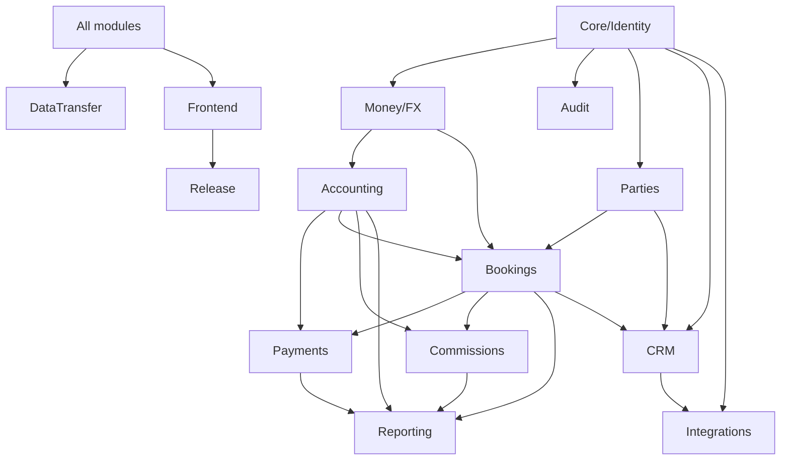

# Module Matrix — Tourism ERP

Status: Implementation-aware design reference (updated 2026-11-12). Companion to `PRD.md`. It describes intended module boundaries; for what is actually shipped, missing, or blocked, `gap-register.md` is authoritative and supersedes any conflicting statement here (for example, Core attachments are listed below but not implemented: GAP-CORE-03).

Legend — Phase: **0** foundation, **1** core, **2** accounting, **3** parties/bookings/payments, **4** tax/commissions/reports, **5** CRM/integrations, **6** UI/QA/release.
Criticality: **P0** launch blocker, **P1** launch required, **P2** should, **P3** later.

## 1. Module ownership and boundaries

A module owns its domain models, migrations, policies, services, API endpoints, jobs, and tests. Cross-module access goes through an approved application service or domain event — never another module's tables.

| Module | Code namespace | Owns | May read (via contract) | Emits events | Consumes events |
|---|---|---|---|---|---|
| Core/Identity | `Core` | users, roles, permissions, branches, settings, feature flags, sequences, audit, attachments | — | `UserCreated`, `BranchUpdated`, `SettingChanged` | — |
| Money/FX | `Money` | currencies, FX rates, money value object, rounding | Core settings | `FxRateChanged` | — |
| Accounting | `Accounting` | accounts, fiscal periods, journal entries/lines, postings, reversals, opening balances, period close | Money, Core | `JournalPosted`, `JournalReversed`, `PeriodClosed` | Booking/BookingPayment/Refund/Expense/Commission/SupplierPayment events |
| Parties | `Parties` | customers, suppliers, contacts, agent/employee payees | Core | `CustomerCreated`, `SupplierCreated` | LeadConverted |
| Bookings | `Bookings` | bookings, booking items, lifecycle, pricing/costing, cancellation policy, profitability | Parties, Money, Tax, Suppliers, Core | `BookingConfirmed`, `BookingCompleted`, `BookingCancelled`, `BookingAdjusted` | LeadConverted |
| Payments | `Payments` | customer receipts, allocations, advances, refunds, supplier obligations/payments, cash/bank transfers | Bookings, Parties, Accounting, Money | `PaymentRecorded`, `RefundIssued`, `SupplierPaid`, `TransferCompleted` | — |
| Tax | `Tax` | tax profiles, calculation snapshots, tax summary | Money, Core | `TaxCalculated` | — |
| Commissions | `Commissions` | rules, accruals, approvals, payouts | Bookings, Parties, Money, Accounting | `CommissionAccrued`, `CommissionPaid` | Booking events |
| Reporting | `Reporting` | report queries, saved definitions, PDF/CSV rendering, export jobs | all via read models | `ReportExported` | — |
| CRM | `CRM` | leads, sources, stages, assignment rules, activities, conversion, reassignment scheduler | Parties, Bookings, Core | `LeadCreated`, `LeadAssigned`, `LeadConverted`, `LeadReassigned` | webhook events |
| Integrations | `Integrations` | Meta/WhatsApp clients, webhook events, credential settings, message log | CRM, Core | `LeadIngested`, `MessageReceived`, `MessageSent` | — |
| DataTransfer | `DataTransfer` | import batches, column mapping, validation, exports | all via contracts | `ImportCompleted`, `ExportCompleted` | — |
| Frontend | `web/` | app shell, routes, screens, i18n, design-system adapters | REST API only | — | — |

## 2. Module matrix (scope, dependencies, deliverables)

| Module | Phase | Crit. | MVP scope | Depends on | Key entities | Key APIs (draft) | Reports | Screens |
|---|---|---|---|---|---|---|---|---|
| Core/Identity | 0–1 | P0 | Auth, users, roles, permissions, branches, settings, feature flags, sequences, audit, attachments, health | — | user, role, permission, branch, setting, sequence, audit_event, attachment | `/auth/*`, `/users`, `/roles`, `/branches`, `/settings`, `/sequences`, `/audit` | audit log | login, users, roles, branches, settings, audit |
| Money/FX | 0–1 | P0 | Currencies, FX rates, money VO, rounding, base currency | Core | currency, fx_rate | `/currencies`, `/fx-rates` | FX rate list | currencies, FX rates |
| Accounting | 2 | P0 | CoA, fiscal periods, journals, reversals, opening balances, cash/bank, transfers, close | Core, Money | account, fiscal_year, fiscal_period, journal_entry, journal_line, opening_batch, period_close | `/accounts`, `/fiscal-years`, `/journal-entries`, `/opening-balances`, `/periods` | GL, TB, IS, BS | CoA, journal entry, period close, opening balances |
| Parties | 3 | P0 | Customers, suppliers + categories, contacts, payees, statements | Core | customer, supplier, contact, payee | `/customers`, `/suppliers` | statements, aging | customers, suppliers, party detail |
| Bookings | 3 | P0 | Multi-service bookings, lifecycle, pricing, profitability, cancellation | Parties, Money, Tax, Suppliers | booking, booking_item, status_history, cancellation | `/bookings` | profitability | booking list/detail/form, cancellation |
| Payments | 3 | P0 | Receipts, allocations, advances, refunds, supplier obligations/payments, transfers | Bookings, Parties, Accounting, Money | payment, allocation, refund, supplier_obligation, supplier_payment, transfer | `/payments`, `/refunds`, `/supplier-payments`, `/transfers` | cash book, AR/AP aging | receipt, refund, supplier payment, transfer |
| Tax | 4 | P0 | Tax profiles, per-line calculation, summary | Core, Money | tax_profile, tax_snapshot | `/tax-profiles`, `/tax-summary` | tax summary | tax profiles, tax report |
| Commissions | 4 | P1 | Rules, accrual, approval, payout, reports | Bookings, Parties, Accounting | commission_rule, commission_accrual | `/commission-rules`, `/commissions` | commission report | rules, accruals, payout |
| Reporting | 4 | P0 | GL, TB, IS, BS, aging, profitability, PDF/CSV | all read | saved_report, export_job | `/reports/*`, `/exports` | all financial/management | report hub, report viewer |
| CRM | 5 | P1 | Leads, sources, stages, assignment, 24h reassignment, activities, conversion | Core, Parties, Bookings | lead, lead_source, lead_stage, assignment_rule, lead_activity | `/leads`, `/lead-stages`, `/assignment-rules` | pipeline, sales metrics | leads board, lead detail, pipeline config |
| Integrations | 5 | P1 | Meta Lead Ads, WhatsApp Cloud API, webhook log, credentials | CRM, Core | webhook_event, whatsapp_message, integration_setting | `/webhooks/meta`, `/webhooks/whatsapp`, `/integrations` | integration event log | integrations, webhook log |
| DataTransfer | 5 | P1 | CSV/Excel import/export framework, templates, async jobs | all via contracts | import_batch, import_row_error, export_job | `/imports`, `/exports` | — | import wizard, export center |
| Frontend shell | 6 | P0 | Shell, nav, i18n/RTL, auth flows, design-system adapters | API | — | — | — | all |
| Release | 6 | P0 | Docker, CI/CD, backup/restore, clean-install acceptance, docs | all | — | — | — | ops docs |

## 3. Dependency graph

Hard rules:
- Accounting has **no** dependency on Bookings/Payments at the domain layer; it exposes posting contracts and consumes events. This keeps the ledger testable in isolation.
- CRM must not write booking tables directly; conversion calls the Bookings application service.
- Reporting reads through query services/read models, never through another module's Eloquent models.
- Integrations depend on CRM contracts only; they never touch the ledger.

## 4. Parallelization plan

Parallel work is allowed only after `03-architecture-contracts` is approved.

| Wave | Can run in parallel | Must finish first |
|---|---|---|
| 0 | Repo scaffold, CI, Docker, auth spike | — |
| 1 | Core/Identity, Money/FX, design-system audit (if assets exist) | Scaffold |
| 2 | Accounting engine; Parties; CRM skeleton | Core + Money + approved contracts |
| 3 | Bookings; Payments; CRM pipeline | Accounting posting contract; Parties |
| 4 | Tax; Commissions; Reports | Bookings + Payments events |
| 5 | Integrations; DataTransfer; module screens | CRM + contracts; design system |
| 6 | QA, release, clean-install | All MVP modules |

File ownership: each workstream owns distinct directories and migrations. Shared contracts (`docs/architecture/openapi.yaml`, event catalog, DB conventions) require architect approval before merge.

## 5. Feature toggles (per installation)

| Toggle | Default | Effect when off |
|---|---|---|
| `crm.enabled` | on | CRM routes/menus hidden; API returns 404/403; integrations disabled. |
| `integrations.meta.enabled` | off | Meta webhook rejects; config hidden. |
| `integrations.whatsapp.enabled` | off | WhatsApp webhook/send disabled. |
| `commissions.enabled` | on | Commission menu/accrual jobs disabled; existing accruals retained. |
| `tax.enabled` | on | Tax fields hidden; zero-rated behavior. |
| `bookings.multi_currency` | on | New documents restricted to base currency. |
| `security.segregation_of_duties` | off | Creator may approve own refunds/payments (still audited). |
| `crm.auto_reassign` | on | 24h reassignment job paused; manual reassignment only. |

Toggles are settings, not code branches. Disabling a module must never corrupt existing data or break reports.

## 6. Explicitly out of scope per module

| Module | Not in MVP |
|---|---|
| Accounting | Bank feed automation, OCR, statutory e-filing, multi-entity consolidation, fixed assets, payroll. |
| Bookings | Supplier portal, dynamic packaging engine, GDS/airline APIs, seat inventory. |
| Payments | Payment-gateway capture, card tokenization, bank API integration. |
| CRM | Marketing automation journeys, email campaign builder, lead scoring ML. |
| Integrations | Additional social channels, SMS gateway (unless approved), two-way Meta ad management. |
| Reporting | Data warehouse, custom report builder, scheduled distribution. |
| Frontend | Native apps, customer-facing portal. |

## 7. Module-level definition of done

A module is complete when: contracts approved; migrations forward + rollback verified; policies on every endpoint; unit/integration tests for happy, failure, authorization, branch scope, idempotency and financial invariants; Arabic/English strings; audit events emitted; reports reconcile; documentation updated; reviewer sign-off.
