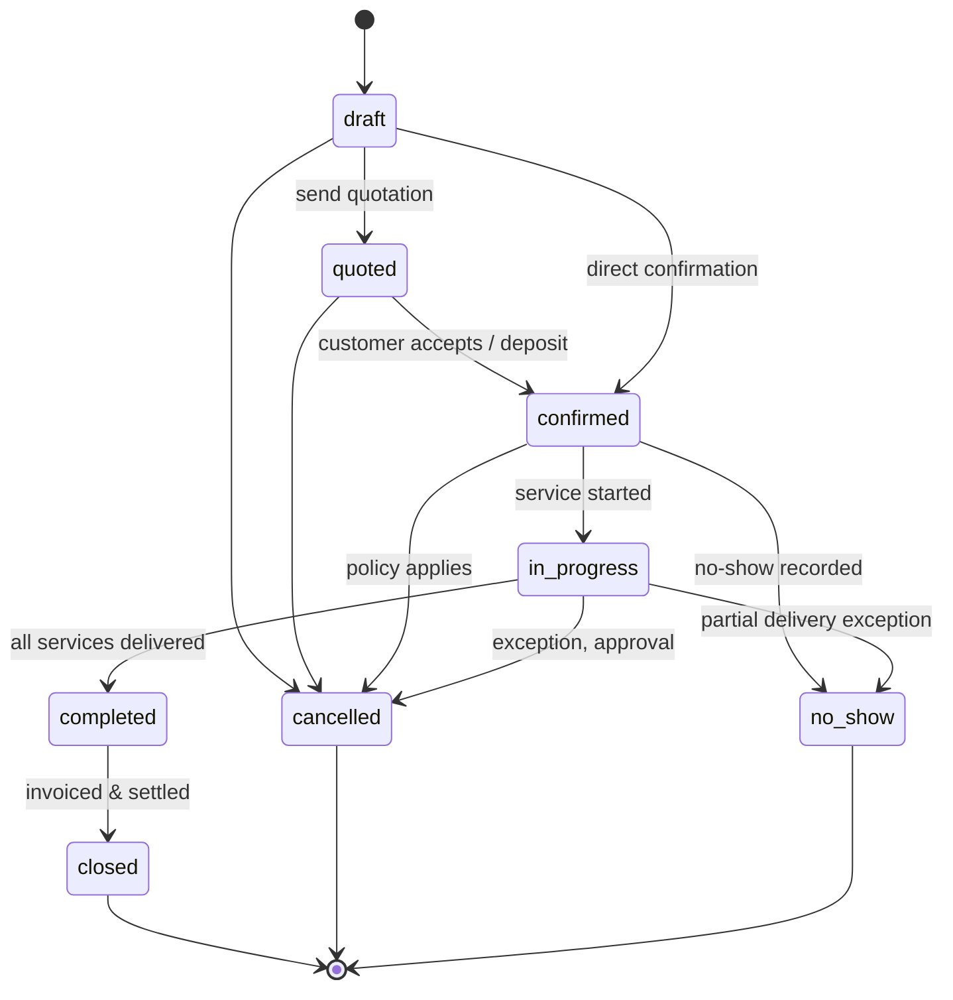
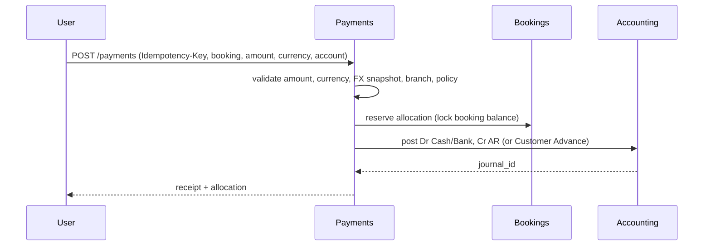
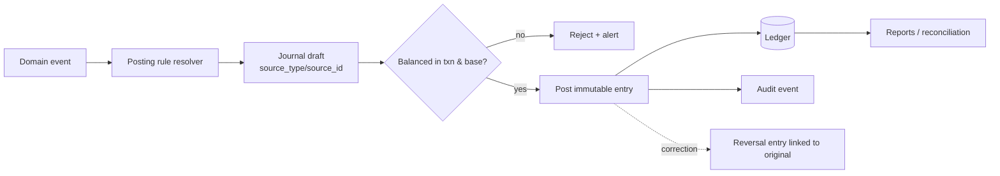
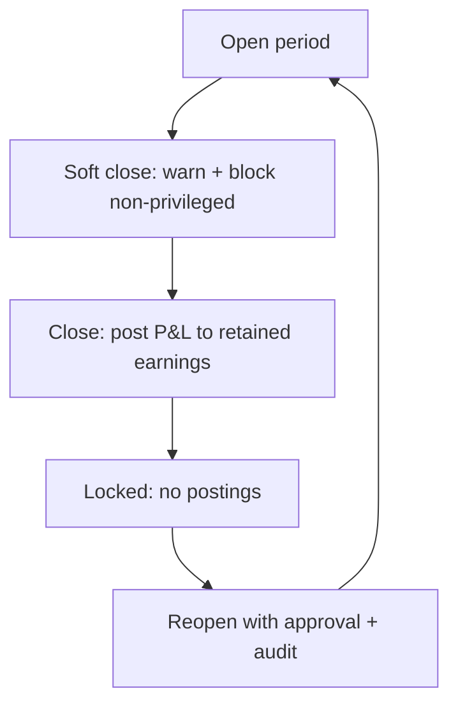
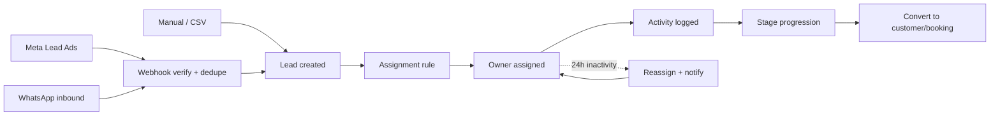

# Workflows — Tourism ERP

Status: Draft. All accounting postings below are **proposals** pending accountant approval (`decisions-needed.md`). Postings are expressed as `Dr` (debit) / `Cr` (credit) with configurable account roles, never hardcoded account numbers.

## 1. Booking lifecycle

| Transition | Guard | Effects | Audit |
|---|---|---|---|
| `draft → quoted` | ≥1 item, valid dates, customer | PDF quotation generated (optional) | status history |
| `→ confirmed` | customer, branch, owner, dates, ≥1 item, sell ≥ 0, FX snapshot | freeze pricing snapshot; emit `BookingConfirmed`; accrual policy may post | status history + event |
| `confirmed → in_progress` | start date reached or manual | none financially | status history |
| `in_progress → completed` | services delivered | emit `BookingCompleted`; revenue recognition per policy | status history + event |
| `completed → closed` | all receipts/refunds settled, commission accrued, supplier obligations settled or approved | period-ready | status history |
| `→ cancelled` | reason + cancellation policy; approval if refund/fee | compute fee/refund; emit `BookingCancelled`; refund workflow | status history + approval |
| `→ no_show` | permission | policy fee/forfeit per decision | status history |

**Edge cases:** edits after confirmation (adjustment document), partial delivery, date changes across fiscal periods, cancellation after revenue recognized, currency rate movement, duplicate submission.

## 2. Customer payment / collection

Rules:
- Payment may be allocated to one/many bookings or held as advance.
- Allocation sum ≤ payment amount; overpayment → advance liability.
- FX: receipt rate may differ from booking rate; AR settled at receipt rate, difference → realized FX gain/loss (decision DEC-007).
- Idempotent replay returns the original receipt; concurrent allocation uses DB transactions + row locks.

**Edge cases:** partial payment, overpayment, cross-currency payment, payment against cancelled booking (requires approval), backdated payment into closed period (rejected), duplicate webhook/manual retry.

## 3. Refund / cancellation

1. Request refund from booking (amount, reason, method, approver).
2. System computes ceiling = net collected − cancellation fee − non-refundable supplier cost (policy).
3. Approval per threshold/segregation.
4. Post: `Dr AR/Refund liability` + `Dr cancellation fee expense?` / `Cr Cash-Bank`; release/void unearned revenue and cost accruals per policy.
5. Update booking status/history; emit `RefundIssued`.

**Edge cases:** refund before payment (blocked), refund after supplier paid (partial), fee exceeds collected (fee receivable), refund in different currency (FX), cancellation after period close (current-period correction + approval).

## 4. Supplier cost and settlement

1. Booking item captures supplier + cost (currency + FX snapshot).
2. On confirmation (or supplier invoice, per DEC-002) create `supplier_obligation`: `Dr Cost of service`, `Cr AP supplier`.
3. Supplier invoice references obligation; matching validates amount/currency/tax.
4. Payment: `Dr AP supplier`, `Cr Cash/Bank`; FX difference → realized gain/loss.
5. Advance to supplier: `Dr Supplier advance (asset)`, `Cr Cash`; later applied to obligation.

**Edge cases:** cost increase after confirmation (adjustment), partial invoice, disputed amount, supplier credit note, payment without obligation (advance), duplicate invoice reference.

## 5. Accounting posting flow (event-driven)

Posting rule roles (configured per installation): `AR`, `AP`, `customer_advance`, `refund_liability`, `service_revenue`, `cancellation_fee_revenue`, `cost_of_service`, `tax_payable`, `tax_receivable`, `commission_expense`, `commission_payable`, `fx_gain`, `fx_loss`, `rounding`, `cash`, `bank`, `retained_earnings`, `due_to_branch`, `due_from_branch`.

Invariants enforced inside one DB transaction:
- debits = credits in transaction currency and base currency;
- account exists, active, postable, and not restricted to another currency;
- period open;
- branch permitted;
- source document exists and is not already posted for that event (idempotency);
- reversal only once and only of a posted entry.

## 6. Revenue / cost recognition matrix (proposal — DEC-001/002)

| Event | Option A (cash-basis friendly) | Option B (accrual, recommended) |
|---|---|---|
| Booking confirmed | memo only | Dr AR, Cr Unearned revenue (liability); Dr Cost of service, Cr AP |
| Service completed | Dr AR, Cr Revenue | Dr Unearned revenue, Cr Revenue |
| Receipt | Dr Cash, Cr AR | Dr Cash, Cr AR |
| Cancellation | reverse unearned; fee to revenue if earned | reverse unearned/revenue as applicable; fee per policy |
| Commission | on collection | on confirmation, adjusted on cancellation |

The chosen option is a single installation setting; the engine must support both without schema change.

## 7. Fiscal period and close

Checks before close: all subledgers reconcile to control accounts, no draft postings in period, unapplied advances reviewed, FX revaluation policy applied (if any), commission accruals reviewed, tax summary reconciled. Reopen requires chief accountant + reason; all post-close corrections are audited.

## 8. Commission accrual and payout

1. Resolve applicable rules (precedence DEC-013) at trigger event.
2. Snapshot basis amounts + rate → accrual (`accrued`).
3. Approve → `approved` (immutable).
4. Payout batch → `Dr commission payable`, `Cr cash/bank`; mark `paid`.
5. Cancellation/refund after accrual → reversal/adjustment accrual (never edit).

**Edge cases:** multiple agents on one booking, rule changed after booking, commission on cancelled booking, payout in different currency, negative margin.

## 9. Lead intake and routing

Rules:
- Webhook signature verified; event ID deduped; raw payload stored redacted; failure queued for retry.
- Assignment precedence: branch+source specific → source → branch → round-robin/load → unassigned queue.
- Inactivity measured from last meaningful activity (call/message/note/stage change), business-calendar aware; default 24h configurable; max reassignment attempts configurable.
- Conversion is one-way, links customer/booking, keeps the lead for reporting; duplicate conversion blocked.
- Opt-out/consent honored for outbound messages.

**Edge cases:** duplicate lead from same phone across sources, reassignment when no eligible user, owner deactivated, webhook replay, malformed payload, Arabic text/encoding, timezone boundaries.

## 10. Import / export

1. Upload file → detect type/encoding → map columns (saved mapping optional).
2. Dry-run validation: required fields, types, duplicates, referential integrity, money/currency, branch permission.
3. Error report downloadable; user fixes and re-uploads; optional partial commit is **not** allowed for financial data (atomic).
4. Commit in a transaction or chunked job with checkpoint; record `import_batch` + row outcomes.
5. Export: apply filters + branch scope + permissions; async for large sets; watermark/audit.

**Edge cases:** Arabic headers, Excel date serials, BOM, mixed currencies, duplicate keys, rows exceeding limits, interrupted jobs, re-import after partial failure (idempotent by batch key).

## 11. FX handling

| Scenario | Treatment (proposal) |
|---|---|
| Document issued in foreign currency | Snapshot rate; store txn + base amounts. |
| Receipt at different rate | Settle AR at receipt rate; difference → realized FX gain/loss. |
| Cross-currency transfer | Two-leg postings; difference → FX gain/loss. |
| Period-end open balances | Optional revaluation per policy (DEC-008); reverse next period if used. |
| Refund at different rate | Refund at original allocation rate or current rate per policy (DEC-007). |

## 12. Failure and recovery behavior

| Failure | Required behavior |
|---|---|
| Posting fails validation | Whole business action rolls back; no partial document; user sees actionable error. |
| Queue job fails | Retried with backoff; after max attempts → failed-job dashboard + alert; idempotent on retry. |
| Webhook duplicate | Return 200, log duplicate, no side effects. |
| Concurrent edit | Optimistic lock/version check; conflict response, no silent overwrite. |
| DB connection loss mid-posting | Transaction rollback; idempotency key prevents double posting on retry. |
| Report timeout | Async export with notification; no partial file marked complete. |
| Closed period posting | Rejected with period details; correction flow offered if authorized. |
